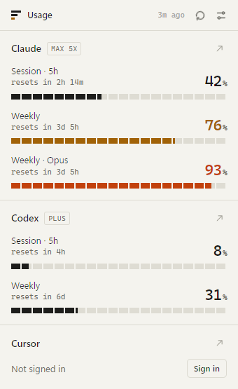
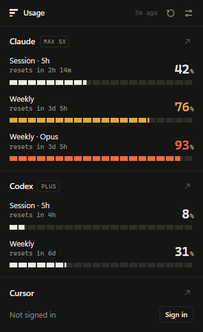

# AI Usage

A small Chrome extension that shows how much of your AI subscription limits you have used, without opening each dashboard.

<p>
  
  &nbsp;
  
</p>

## Supported services

| Service | What is shown | Source |
| --- | --- | --- |
| Claude | 5-hour session, weekly, weekly Opus / Sonnet | `claude.ai/api/organizations/{id}/usage` |
| Codex (ChatGPT) | Short window and weekly Codex limits | `chatgpt.com/backend-api/wham/usage` |
| Cursor | Included usage for the billing cycle, on-demand spend | `cursor.com/api/usage-summary` |

You only need to be signed in to the service in the same Chrome profile. Services you are not signed in to show a **Sign in** button.

## Features

- One popup for every service, with reset countdowns
- Highest usage shown as a badge on the toolbar icon
- Background refresh every 5, 15, 30 or 60 minutes
- Turn individual services on or off
- Light and dark themes that follow your system
- English and Turkish interface

## Install

The extension is not on the Chrome Web Store yet, so load it unpacked:

1. Download or clone this repository.
   ```
   git clone https://github.com/emrek57/ai-usage-extension.git
   ```
2. Open `chrome://extensions` and enable **Developer mode**.
3. Click **Load unpacked** and select the cloned folder.
4. Pin **AI Usage** from the extensions menu.

To update, pull the latest changes and press the reload button on the extension card.

## Privacy

- No accounts, no analytics, no remote servers of its own.
- Requests go directly from your browser to the services above using the session you already have.
- Results are kept in `chrome.storage.local`; settings sync through `chrome.storage.sync`.

## Permissions

| Permission | Why |
| --- | --- |
| `host_permissions` for claude.ai, chatgpt.com, cursor.com | Read usage from each service with your existing session |
| `storage` | Save the latest results and your settings |
| `alarms` | Refresh in the background |
| `scripting` | If a service blocks background requests, retry the same request from a tab you already have open on that site |

## How it works

```
src/
  background.js      refresh loop, badge, message handling
  lib/http.js        fetch helper with open-tab fallback
  lib/settings.js    defaults and synced settings
  providers/         one file per service
  popup/             popup UI
```

Each provider exports an object with `id`, `name`, `home`, `login` and an async `load()` that returns:

```js
{
  plan: 'Pro',
  windows: [
    { label: 'session', span: 18000000, percent: 42, resetsAt: 1767225600000 }
  ]
}
```

`label` is a key from `_locales/*/messages.json`. Throw `SignedOutError` (or let a 401 bubble up) when the user is not signed in.

### Adding a service

1. Create `src/providers/<name>.js` following the shape above.
2. Register it in `src/providers/index.js`.
3. Add the domain to `host_permissions` in `manifest.json`.
4. Add any new label keys to both locale files.

## Caveats

These endpoints are the same internal ones the official web apps use. They are undocumented and can change without notice. If a service stops loading, please open an issue with the error shown in the popup.

This project is not affiliated with Anthropic, OpenAI or Anysphere.

---

## Türkçe

Claude, Codex ve Cursor hesaplarındaki kullanım limitlerini tek bir açılır pencerede gösteren Chrome uzantısı.

**Kurulum**

1. Depoyu indir veya klonla.
2. `chrome://extensions` adresini aç ve **Geliştirici modu**nu etkinleştir.
3. **Paketlenmemiş öğe yükle**'ye tıklayıp klasörü seç.
4. Uzantılar menüsünden **AI Usage**'ı sabitle.

Uzantı yalnızca aynı Chrome profilinde açık olan oturumlarını kullanır. Veriler başka hiçbir sunucuya gönderilmez. Arayüz, Chrome dilin Türkçe ise otomatik olarak Türkçe görünür.

## License

[MIT](LICENSE)
